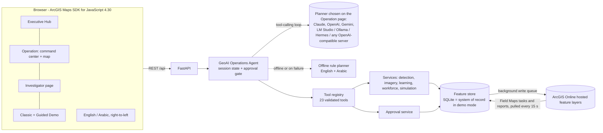
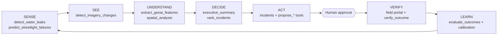

# Architecture

**One Agent. One Geospatial Intelligence Platform. One Continuous Operational Lifecycle.**

## Responsibilities (kept separate)

| Layer | Code | Rule |
|---|---|---|
| Reasoning | `backend/agent/` | Chooses tools, explains results. Never computes numbers, scores or record updates. |
| Tools | `backend/tools/` | JSON-schema tools with input validation, timing and audit; failures return structured errors. |
| GIS / data | `backend/gis/` | Schema validation, store, ArcGIS Online adapter, geodesy helpers. |
| Business rules | `backend/services/`, `backend/workflows/` | Risk scoring, detection, learning, approvals, actions. |
| Presentation | `frontend/`, `backend/api/` | Thin; every figure is fetched from the API. |
| Language | `frontend/i18n.js`, `backend/services/i18n.py`, `backend/agent/ar.py` | The database and ids stay English; `?lang=ar` translates backend sentences; the pages mirror to right-to-left. |

## Lifecycle and where each stage lives

Approval gate: `propose_*` tools only write an `Riyadh_Approvals` row (status `Proposed`). Execution happens in `ApprovalService.approve`, called by the
approval-panel REST endpoint or by the chat router when the **human** types "approve" - the model has no approval tool. The handler verifies the write by reading
it back; ArcGIS Online mirror failures are surfaced as warnings, never silently dropped.

## Honest status of each "intelligence" component

| Capability | Implementation | Data |
|---|---|---|
| Leak detection | Real: day-over-day robust z-score, flow corroboration, neighbour-sensor localisation, risk scoring | Synthetic sensors |
| Streetlight prediction | Real: logistic regression trained on synthetic labelled samples (80%) + IsolationForest percentile (20%), DBSCAN clusters | Synthetic telemetry |
| Change detection | Real algorithm (radiometric normalisation, NDVI/NDBI differencing, adaptive threshold, morphology, components) | **Simulated** 4-band scenes |
| Feature extraction | Real thresholding/morphology on the simulated scene; **no deep-learning model executed** | Simulated |
| Pole monitoring | Real limits on simulated tilt and corrosion; merged into the lamp's detection (one use case) | Synthetic telemetry |
| Visual distortion | Eight incident types (construction waste, abandoned vehicles, illegal graffiti, non-compliant billboards, unlicensed canopies and hangars, unregulated street vendors, neglected vacant land, exposed wiring) plus structural shape change, scored per location against the area norm | **Simulated** imagery epochs |
| Land-use management | Change detection between the two dates, classified and checked against each area's zoning: violation = land-use incident, permitted growth = urban-change review | **Simulated** imagery, reference zoning |
| Learning | Feedback records, precision/recall, per-category calibration multiplier, streetlight threshold; **no retraining** | Seeded + live outcomes |

## Persistence
`data/geoai.sqlite` holds every layer (`features(layer,id,attrs,geom)`), counters, approvals, audit log and learning config. Conversation state (focus ids) is in process memory per session; all
operational records survive restarts. With ArcGIS Online credentials the same writes are forwarded to hosted layers (`backend/gis/agol.py`).

## Field Maps
Approved assignments become Tasks on `GeoAIOps_Riyadh_Work_Orders`; the investigator answers with the **Answer** pick list (`Field_Verdict`), **Note** and **Finish**, or files a report on the Field verification layer (radio buttons, GPS, photo). The server pulls both and assesses them like the in-app form. A confirmed fault is closed after a repair report from the field or, in a demo, a simulated crew (**Simulate repair**); closing always needs the operator's approval. See `docs/field_maps.md`.
