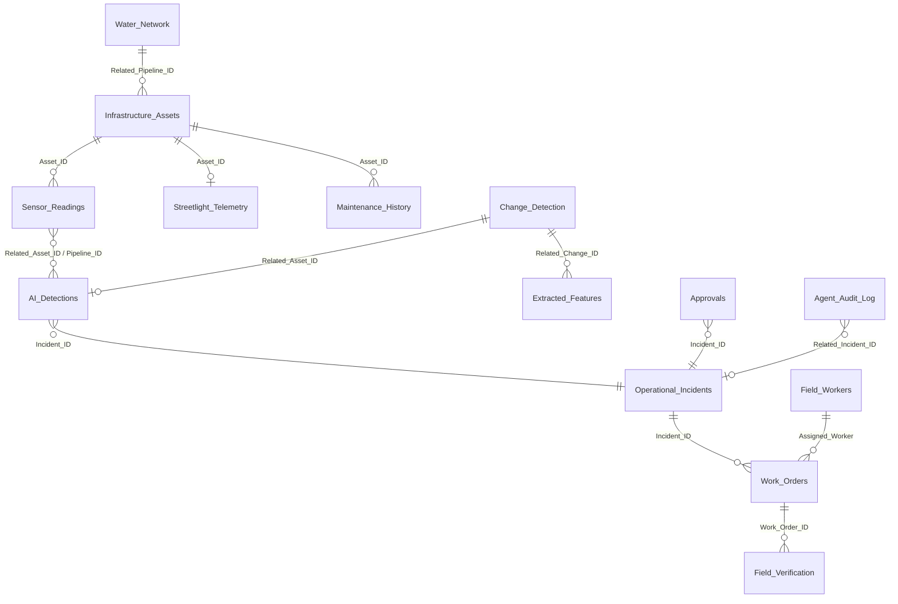

# Data dictionary

Source of truth: `backend/gis/schema.py` (field lists are enforced on every write).
`Data_Classification` values: `SYNTHETIC-DEMO` (generated), `SIMULATED-PROCESSING` (algorithmic output on simulated or synthetic inputs), `REFERENCE-APPROXIMATE` (hand-placed landmarks), `DEMO-OPERATIONAL` (records created by operators/agent in the demo).

| Layer | Geometry | Key | Notes |
|---|---|---|---|
| Riyadh_Infrastructure_Assets | Point | Asset_ID | `AST-W-*` pipe segment (midpoint), `AST-S-*` sensor, `AST-L-*` streetlight. Roadside lights are offset 11 m from approximate corridor centrelines. |
| Riyadh_Water_Network | Polyline | Pipeline_ID | `PIPE-<AREA>-nnn`, 4x4 node mesh per area, 24 segments each. |
| Riyadh_Sensor_Readings | Point | Reading_ID | Pressure kPa, flow L/s (water, hourly x48 h) and lamp power W (daily x12). `Sensor_ID` links readings to a sensor. |
| Riyadh_AI_Detections | Point | Detection_ID | Status: Suspected / Predicted / Candidate -> Verified-True / Verified-False. `Evidence` states why, and that it is not confirmed. |
| Riyadh_Change_Detection | Polygon | Change_ID | `CHG-<AREA>-nnn`, deterministic per area/epoch pair. `Significant` is configurable-threshold output. |
| Riyadh_Extracted_Features | Polygon | Feature_ID | Building footprints / road segments from the simulated scene. |
| Riyadh_Operational_Incidents | Point | Incident_ID | Status: Open -> Work Order Created -> Assigned -> Confirmed / Rejected / Requires Further Inspection / Escalated -> Repair Reported -> Resolved / Closed - False Positive. |
| Riyadh_Work_Orders | Point | Work_Order_ID | Status: Created -> Assigned -> In Progress -> Completed. One active work order per incident (enforced). Field Maps task fields `esritask_*` are derived from it; `Field_Verdict` (Confirmed / Rejected / Needs Further Inspection / Escalate / Repaired, chosen with the Answer button) and `Field_Comment` hold the investigator's answer and comment. |
| Riyadh_Field_Verification | Point | Verification_ID | GPS, distance to detection, photo URL (`/api/evidence/...`; files in `data/evidence/`), agent assessment, `Simulated_Worker`. |
| Riyadh_Executive_Indicators | table | Indicator_ID | Rewritten from computed KPIs each time the unfiltered executive summary runs. |
| Riyadh_Agent_Audit_Log | table | Log_ID | Every tool call, proposal, approval, execution, field submission. |
| Riyadh_Field_Workers / Reference_Facilities / Maintenance_History / Streetlight_Telemetry / Approvals / Learning_Config / Sim_Events | support | - | Support layers. |
| Riyadh_Sim_Ground_Truth | internal | Truth_ID | Simulator-only; never exposed through the API or agent tools. Drives simulated field answers and false-negative counts. |

Not stored in attributes: images (referenced by URL; ArcGIS attachments are the production route).
